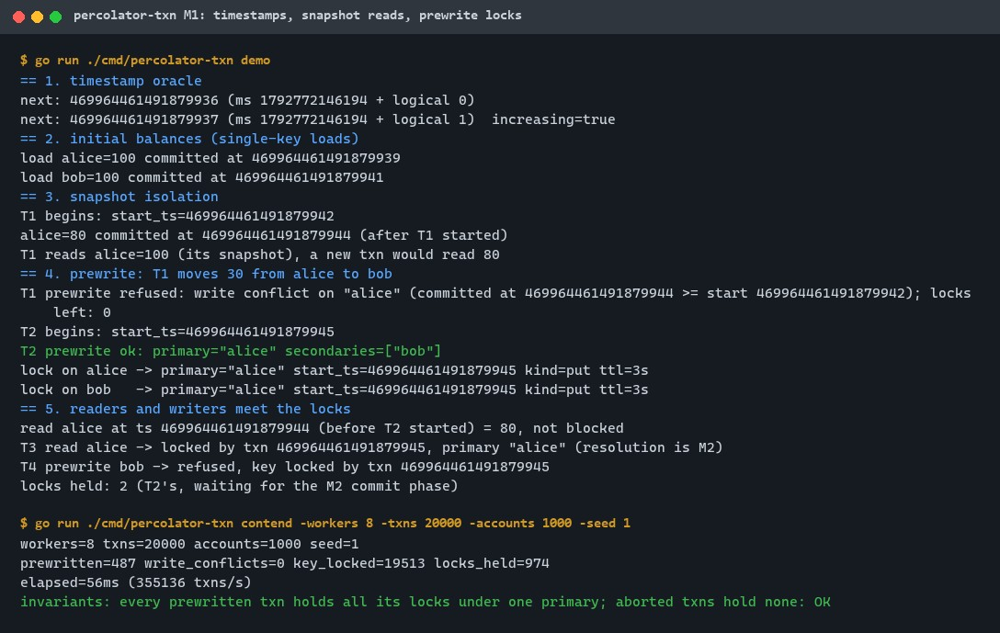
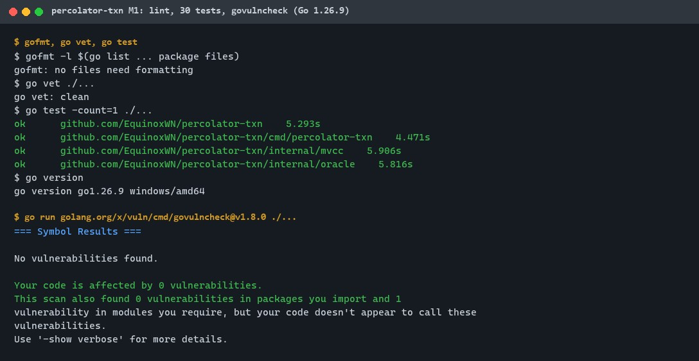
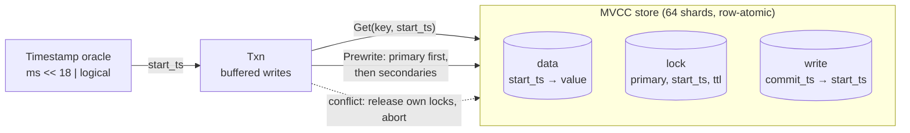
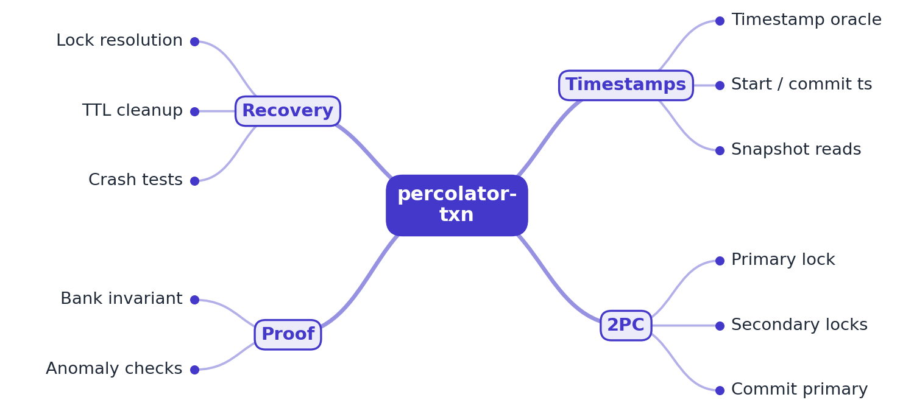

# percolator-txn

[](https://github.com/EquinoxWN/percolator-txn/actions/workflows/ci.yml)


> Money must never be lost or double-counted across shards: Percolator-style distributed transactions, built step by step. M1: a timestamp oracle, snapshot-isolated reads and the prewrite phase with a primary lock.

Part of my **Distributed Systems & Storage** list · Go

> Builds on: [multi-raft-kv](https://github.com/EquinoxWN/multi-raft-kv) (planned storage backend)

## Proof it works

The demo walks through M1: the oracle issues increasing hybrid timestamps, a transaction keeps
reading its snapshot after a newer commit, its prewrite is refused for a write conflict and
leaves no lock, a second transaction locks both keys under the primary `alice`, and later
readers and writers meet those locks. The contention run sends 20,000 transfers from 8 clients
and checks every lock:



gofmt and go vet are clean, all 31 tests pass (the screenshot is from the M1 run with 30), and govulncheck finds no vulnerabilities
affecting the code with Go 1.26.10, the version CI uses:



## Architecture

**What M1 runs today:**



**Full roadmap (M1 to M3):**



## How it works

_Steps 1 and 2 are built and tested (M1); the rest is on the [roadmap](#roadmap)._

1. A timestamp oracle issues monotonically increasing timestamps; each transaction reads at its start timestamp (snapshot isolation).
2. At commit the client prewrites every key with a lock, choosing one key as the primary lock.
3. Committing the primary atomically commits the whole transaction; secondaries are committed afterwards or lazily.
4. A reader that meets a lock checks the primary to roll forward or back, so a crashed client never blocks others for long.
5. A bank-transfer test runs thousands of concurrent transfers with crashes and checks the total never changes.
6. An anomaly checker documents what snapshot isolation prevents, and shows a write-skew case with its fix.

In M1 specifically:

- **Timestamps:** physical milliseconds shifted left 18 bits plus a logical counter. A clock
  that goes backwards, or more than 262,144 calls in one millisecond, never produces a repeated
  or smaller timestamp ([ADR 0002](docs/adr/0002-hybrid-timestamps.md)).
- **Reads:** a read at `ts` follows the newest write record with `commit_ts <= ts`. A lock with
  `start_ts <= ts` returns `KeyLockedError` (that transaction may still commit inside the
  snapshot); a younger lock is ignored.
- **Prewrite:** the smallest key becomes the primary and is locked first. A version committed
  at or after `start_ts` gives `WriteConflictError`; another transaction's lock gives
  `KeyLockedError`. On either, the client releases the locks it already placed and aborts.

## Who it helps

- **Who:** Engineers learning or reviewing distributed transaction code such as TiKV/TiDB's
  Percolator implementation, and candidates preparing for "how do distributed transactions
  work?" interviews.
- **The problem:** The rules (which reads may pass a lock, what is a write conflict, what a
  failed prewrite must undo) are short on paper and easy to get subtly wrong in a large codebase.
- **How to use it:** Run `make demo` to watch each rule fire, read the store (~330 lines), client (~220) and oracle (~90), and
  change a rule to see which tests fail (the random-history test compares every read
  with a reference model of snapshot isolation).

## Tech stack

| Area | In M1 | Planned |
|---|---|---|
| Core | Go (standard library only), hybrid timestamp oracle, in-memory MVCC store with data/lock/write columns, prewrite with primary lock | Commit phase, lock resolution via the primary, multi-raft-kv backend |
| Test | Unit tests, randomized histories against a reference model, concurrent prewrite tests, contention CLI with invariant checks, `testing.B` benchmarks | Bank-transfer test with injected client crashes |
| Analysis | Snapshot-read rules documented in the RFC | Anomaly checker for lost updates and write skew |

| Path | What it is |
|---|---|
| `percolator.go` | Public API: `New`, `Client.Begin`, `Txn.Get/Set/Delete/Prewrite/Rollback`, `Client.Load` |
| `internal/oracle` | Hybrid timestamp oracle |
| `internal/mvcc` | Row store with data, lock and write columns |
| `cmd/percolator-txn` | `demo` walkthrough and `contend` invariant check |

## Run it

Needs Go 1.23 or newer (CI uses 1.26.10).

```bash
make test      # all tests with the race detector (needs cgo; `make test-norace` otherwise)
make demo      # scripted walkthrough of the M1 rules
make contend   # 20,000 transfers from 8 clients, invariant check on every lock
make bench     # oracle, snapshot read and prewrite benchmarks
make audit     # govulncheck
```

As a library:

```go
c := percolator.New(percolator.Options{})
_, _ = c.Load([]byte("alice"), []byte("100")) // initial data (single-key commit)
txn := c.Begin()                              // start_ts from the oracle
v, ok, err := txn.Get([]byte("alice"))        // snapshot read; *KeyLockedError if blocked
_ = txn.Set([]byte("alice"), []byte("70"))
_ = txn.Set([]byte("bob"), []byte("130"))
res, err := txn.Prewrite() // res.Primary == "alice"; conflicts abort and release locks
```

## Tests and results

Latest local run (Intel Core i7-13700H, Windows 11): lint, tests and govulncheck re-run with Go 1.26.10 on
2026-10-30; the contention run and benchmarks were recorded with Go 1.26.9. Full detail, every test and the
DMAIC table in [docs/results/m1.md](docs/results/m1.md).

| Test file | Tests | What it proves |
|---|---|---|
| `internal/oracle/oracle_test.go` | 7 | Strictly increasing and unique timestamps: 100,000 sequential, 8 x 10,000 concurrent, clock going back 500 s, logical overflow, restart floor; an oversized logical part never spills into the physical bits |

Quality check against the 10 engineering rules, with the mutation table: [docs/quality/2026-11-01.md](docs/quality/2026-11-01.md).
| `internal/mvcc/store_test.go` | 13 | Snapshot reads, delete visibility, lock blocking rules, write-conflict and lock-conflict detection, idempotent retry, safe release, input bounds, ordered history, copied values, 200 random histories x 400 ops against a reference model, 16 goroutines racing for 32 rows |
| `percolator_test.go` | 8 | Transactions read their start snapshot and their own writes, every key locked under the smallest key as primary, aborted prewrites release their locks, lifecycle and the 10,000-mutation bound, 20 seeds of concurrent transfers |
| `cmd/percolator-txn/main_test.go` | 3 | Demo output covers every M1 step, contention invariants hold, bad arguments refused |

| Check | Result |
|---|---|
| Tests | 31 passed, 0 failed |
| gofmt, go vet | clean |
| govulncheck v1.8.0 (Go 1.26.10) | No vulnerabilities found |
| Random histories vs SI model | 200 x 400 operations, 0 mismatches |
| Contention run (8 clients, 20,000 transfers, 1,000 accounts) | 487 prewritten, 19,513 refused by locks, 974 locks held, invariants OK |
| Timestamp `Next` | 114 ns (one caller), 196 ns (20 threads) |
| Snapshot `Get` (10,000 keys x 10 versions) | 1.75 µs |
| Two-key prewrite (begin, 2 sets, prewrite) | 6.2 µs |

The race detector runs in CI only (it needs cgo, which the local machine lacks). Without a
commit phase, successful prewrites keep their locks, which is why most transfers in the
contention run are refused; commit and lock resolution are M2.

## Roadmap

**M1** (≈8 h)
- [x] Write `docs/rfc/0001-design.md`: problem, goals, non-goals, chosen design
- [x] A timestamp oracle issues monotonically increasing timestamps; each transaction reads at its start timestamp (snapshot isolation).
- [x] At commit the client prewrites every key with a lock, choosing one key as the primary lock.

**M2** (≈8 h)
- [ ] Committing the primary atomically commits the whole transaction; secondaries are committed afterwards or lazily.
- [ ] A reader that meets a lock checks the primary to roll forward or back, so a crashed client never blocks others for long.

**M3** (≈9 h)
- [ ] A bank-transfer test runs thousands of concurrent transfers with crashes and checks the total never changes.
- [ ] An anomaly checker documents what snapshot isolation prevents, and shows a write-skew case with its fix.
- [ ] Publish the proof below with real numbers

## Proof

What this repo must show before it counts as done:

- Bank-invariant results under crashes, and a reproduced write-skew example with its fix.

| Result | Value |
|---|---|
| M3 proof above | Not measured yet (M3). Current M1 numbers: see [Tests and results](#tests-and-results). |

## Why it matters

- **Interview angle:** 'How do distributed transactions work?': 2PC, isolation levels and their anomalies.
- **Upstream I'd like to contribute to:** TiDB / TiKV transaction code, or Apache Seata (from Alibaba) samples and docs.

## Design docs

- [RFC 0001: design](docs/rfc/0001-design.md)
- [ADR 0001: record architecture decisions](docs/adr/0001-record-architecture-decisions.md)
- [ADR 0002: hybrid physical-logical timestamps from a single oracle](docs/adr/0002-hybrid-timestamps.md)
- [M1 results](docs/results/m1.md)

## Scope

This is a learning and portfolio system, not a hosted production service. Everything runs
locally and in memory; there is no networking or persistence in M1.

## Security and contributing

- Every GitHub Action is pinned to a commit SHA; workflows run read-only, without persisted credentials.
- Dependabot update pull requests are paused (`open-pull-requests-limit: 0`) so the repository keeps a single `main` branch; dependencies are updated by hand and checked by the CI audit.
- Keys, values and write sets are bounded (4 KiB, 1 MiB, 10,000 mutations); stored bytes are copied in and out.
- `gofmt`, `go vet` and the race detector on every push; `govulncheck` (`make audit`) in CI.
- Report vulnerabilities privately: see [SECURITY.md](SECURITY.md). To contribute, see [CONTRIBUTING.md](CONTRIBUTING.md).

## License

MIT, see [LICENSE](LICENSE).
