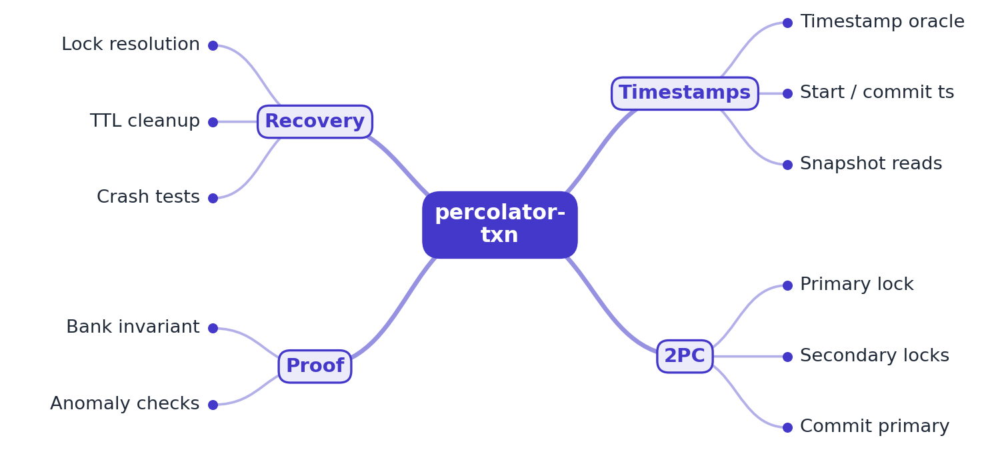

# RFC 0001: percolator-txn design

- **Status:** Accepted (M1 implemented: timestamp oracle, snapshot reads, prewrite)
- **Author:** EquinoxWN
- **Created:** 2026

## Problem

A transfer between two accounts touches two keys that may live on different shards. If the
system can commit one key and crash before the other, money is lost or created. Google's
Percolator (Peng and Dabek, OSDI 2010) and its descendant in TiKV solve this with snapshot
isolation and a client-driven two-phase commit over a store that only offers single-row
atomicity. The protocol is short to describe and easy to get subtly wrong (which reads may pass
a lock, what counts as a write conflict, what a failed prewrite must undo). This project
builds it step by step, with tests that pin each rule down.

**Users:** engineers learning or reviewing distributed transaction code (TiKV, TiDB,
CockroachDB-style systems) who want a small, readable implementation with executable rules.

## Goals

Critical-to-quality measures (Define), with the M1 target for each:

| CTQ | Target (M1) | How it is checked |
|---|---|---|
| Timestamp monotonicity | 0 non-increasing or duplicate timestamps, including clock regressions and more than 2^18 calls per millisecond | `internal/oracle` tests (100,000 sequential calls, 8 x 10,000 concurrent calls) |
| Snapshot correctness | 0 reads that differ from a reference model of snapshot isolation | 200 random histories x 400 operations against a slice model |
| Lock exclusivity | 0 keys locked by two transactions; 0 locks left by an aborted prewrite | concurrent prewrite tests and `contend` CLI invariant check |
| Bounded input | keys <= 4 KiB, values <= 1 MiB, <= 10,000 mutations per transaction, all refused beyond | input validation tests |

Later milestones (not in M1): committing the primary commits the transaction and
secondaries roll forward (M2); readers that meet a lock resolve it via the primary (M2); a
bank-transfer test with crashes and a write-skew anomaly checker (M3).

## Non-goals

- Networking, replication and sharding: the store is in-memory and in-process. The protocol
  only relies on single-row atomicity, so a multi-raft-kv backend can replace it later.
- Serializable isolation. Snapshot isolation allows write skew; M3 documents and demonstrates it.
- Running as a hosted production service.

## Proposed design

### Timestamp oracle (`internal/oracle`)

A hybrid timestamp, as in TiKV's PD: `physical milliseconds << 18 | logical counter`. `Next`
takes a mutex, reads the clock and:

- if the clock moved forward, uses it with logical 0;
- otherwise increments the logical counter;
- if the counter is exhausted, borrows the next millisecond.

So every timestamp is strictly greater than the previous one even when the wall clock goes
backwards. `WithFloor` starts above a persisted value, which is how a restarted oracle avoids
reissuing timestamps (persisting the floor is M2 work with the commit path).

### Store (`internal/mvcc`)

Each key is a row with Percolator's three columns:

| Column | Content | Written by |
|---|---|---|
| data | `start_ts -> value` | prewrite (and `Load`) |
| lock | at most one `{primary, start_ts, kind, ttl}` | prewrite |
| write | `commit_ts -> {start_ts, kind}`, newest first | commit (M2) and `Load` |

Rows are spread over 64 shards, each guarded by a mutex: one row operation is atomic, nothing
spans rows. Inputs are copied in and out.

- **Get(key, ts):** if the row holds a lock with `start_ts <= ts`, return `KeyLockedError`:
  that transaction may commit with a timestamp the reader must see, so the reader cannot answer
  yet. A lock with `start_ts > ts` is ignored, since its commit timestamp will be larger still.
  Otherwise follow the newest write record with `commit_ts <= ts` to its data.
- **Prewrite(m, primary, start_ts):** fail with `WriteConflictError` if a write record has
  `commit_ts >= start_ts` (someone committed after we took our snapshot); fail with
  `KeyLockedError` if another transaction holds the lock; otherwise write data at `start_ts` and
  the lock. Repeating a successful prewrite with the same `start_ts` is a no-op.
- **ReleaseOwn(key, start_ts):** remove the lock and data only if the lock belongs to `start_ts`.
- **Load(m, start_ts, commit_ts):** install a committed version of one key (initial data and
  tests). It refuses locked rows and commit timestamps that are not newer than the row's latest.

### Client (`percolator.go`)

`Begin` takes a start timestamp. `Get` returns the transaction's own buffered write or the
snapshot read. `Set`/`Delete` buffer mutations. `Prewrite` sorts the keys, makes the smallest
the primary, prewrites the primary first and then the secondaries, all pointing at the primary.
On any error it releases the locks it placed (in reverse order) and the transaction becomes
aborted. After success the locks stay until the commit phase (M2).

## Alternatives considered

| Option | Why not (yet) |
|---|---|
| Classic 2PC with a coordinator log | Needs a separate durable coordinator whose crash blocks participants. Percolator puts the commit decision in the primary row instead, so any reader can find it; that is the property this project studies. |
| Single global lock or serial execution | Trivially correct, but it hides every interesting failure mode and does not scale beyond one node. |
| Serializable snapshot isolation (SSI, as in PostgreSQL) | Prevents write skew, but needs read-set tracking and dangerous-structure detection. SI first; write skew and its fix (materialising the conflict) are the M3 analysis. |
| Pure logical counter oracle | Simpler, but timestamps carry no wall-clock meaning, so lock TTLs (M2) cannot be compared with time. The hybrid keeps both. See ADR 0002. |
| Random primary choice | Spreads load, but makes runs non-deterministic and hard to test; smallest key is deterministic. |

## Measurement plan

- **M1:** the CTQ checks above, plus micro-benchmarks (`make bench`: oracle `Next`, snapshot
  `Get`, two-key prewrite) and the `contend` command (many concurrent transfers, invariant check
  on every lock). Results in `docs/results/m1.md`.
- **M3:** bank-invariant results under injected client crashes (total balance constant across
  thousands of transfers) and a reproduced write-skew example with its fix.

## Milestones

- **M1 (done):** timestamp oracle with snapshot reads; prewrite with a primary lock.
- **M2:** commit the primary to commit the transaction; lock resolution via the primary.
- **M3:** bank-transfer test with crashes; anomaly checker for write skew.

## Risks and open questions

- The oracle is in-process; a networked oracle needs batching to stay off the critical path.
- Without the commit phase, prewritten locks stay forever in M1; any long-running test that
  expects progress must wait for M2.
- `ReleaseOwn` leaves no rollback record. With an in-process, synchronous store a delayed
  prewrite cannot arrive after the release; once messages can be delayed (M2 lock resolution),
  a rollback record is needed so a late prewrite cannot resurrect an aborted transaction.
